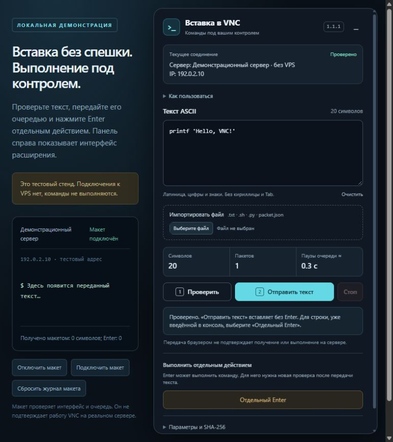

# VDSina VNC Paste Bridge

Расширение Edge/Chrome для последовательной вставки команд и кода в VNC-консоль VDSina. Текст передаётся частями до 256 символов с посимвольными паузами. Панель показывает сервер, предпросмотр, объём текста и ход передачи; доступны импорт файла, остановка и отдельный Enter. Версия интерфейса — **1.1.1**.

**Начните с [руководства пользователя](docs/USER_GUIDE.md): установка, первая команда, пояснения кнопок и решение частых проблем.** В самой панели есть раскрываемая помощь «Как пользоваться».



## Установка

1. Скачайте архив исходников этого репозитория и распакуйте в постоянный каталог.
2. Откройте `edge://extensions` или `chrome://extensions` и включите режим разработчика.
3. Нажмите «Загрузить распакованное расширение» и выберите папку `extension`.
4. Откройте VNC нужного сервера из панели VDSina. Для уже открытой консоли обновите страницу. Панель расширения работает на `https://cp.vdsina.ru/static/novnc/start.html`.

После обновления файлов расширения нажмите Reload в списке расширений, затем обновите вкладку VNC. Номер версии виден в панели.

## Вставка

1. Проверьте название VPS и IP в панели и убедитесь, что консоль готова принять текст.
2. Вставьте текст в поле или импортируйте UTF-8 файл либо подготовленный JSON-пакет. Проверьте предпросмотр и настройки перевода строк.
3. Нажмите «Проверить», затем «Отправить текст». Во время передачи не вводите текст в консоль вручную.
4. После окончания проверьте строку в самой консоли. Если требуется выполнить её, снова нажмите «Проверить», затем «Отдельный Enter».

Финальный Enter автоматически не добавляется. Кнопка «Стоп», разрыв соединения или смена сервера прекращают очередь без автоматического продолжения. Если результат неизвестен, сначала проверьте состояние на сервере: повтор может выполнить команду дважды. Счётчик отправленных символов подтверждает только работу браузера; получение и выполнение подтверждаются серверным результатом.

## Ограничения

- Печатные ASCII-символы; UTF-8 без BOM. Кириллица, CR/CRLF, Tab и остальные управляющие символы отклоняются.
- LF допускается только при явно выбранном режиме LF → Enter. Каждый такой перевод строки может выполнить команду. Завершающий LF в исходном файле также передаётся.
- Максимум 32768 байт; очередь ограничена расчётным временем 10 минут. Части до 256 символов — настройка расширения, а не установленный предел кнопки VDSina.
- Для пунктуации и заглавных букв используется явный Shift. Гостевая раскладка и CapsLock должны соответствовать проверенным условиям; расширение не определяет их автоматически.
- Перед вводом проверяются хеши публичных исходников VDSina/noVNC и функции клавиатуры. Если сайт изменился, передача блокируется; эту проверку нельзя обходить сменой флага.

Расширение не читает системный буфер обмена, cookies или пароли, не сохраняет историю команд и не создаёт свой WebSocket. Разрешения ограничены страницей VDSina VNC и loopback API.

## CLI и локальный API

Python 3.10+; только стандартная библиотека. Из каталога проекта:

```powershell
python -B -m cli pack examples/command.txt --out runtime/packet.json
```

Импортируйте `runtime/packet.json` в панель расширения. Для локального API:

```powershell
.\Start-Bridge.ps1 -TextFile '.\examples\command.txt'
```

При необходимости укажите `-PythonPath 'C:\Python\python.exe'`, `-Port 8766` или `-Multiline`. Импортируйте `runtime/connection.json` в расширение. Файл содержит действующий токен: не публикуйте его. API слушает только `127.0.0.1`; после перезапуска нужен новый файл подключения. Подробности — [CLI.md](CLI.md), форматы — [CONTRACT.md](CONTRACT.md).

## Разработка и проверки

Для разработки нужна полная рабочая копия репозитория, Node.js 20+ и Python 3.10+; установка npm/Python зависимостей не нужна. Архив установки из `dist/` содержит только пользовательский комплект.

```powershell
python -B scripts/fetch_fixtures.py
npm test
python -B -m unittest discover -s tests -p 'test_*.py' -v
npm run serve:harness
```

Первый шаг получает сторонние тестовые исходники из публичных источников и сверяет закреплённые SHA-256; изменение файла останавливает подготовку. Эти файлы игнорируются Git и не попадают в архив расширения. Для проверки уже скачанных файлов без сети используйте `python -B scripts/fetch_fixtures.py --verify-only`.

Локальный стенд доступен по `http://127.0.0.1:4173/` и не подключается к VPS. Тесты проверяют очереди, ограничения, API, noVNC/RFB и модель гостевой клавиатуры QEMU/US. Они не подтверждают установку в браузере или доставку на конкретный VPS. Такие результаты требуют отдельной живой проверки с серверной длиной и SHA-256.

Архив для установки создаётся командой `python -B scripts/package.py`. Упаковщик включает только явный список файлов расширения, CLI, документации и примеров; журналы, токены, тестовые сторонние исходники и локальные результаты исключены.

Собственный код публикуется как `UNLICENSED`; см. [LICENSE.md](LICENSE.md).
