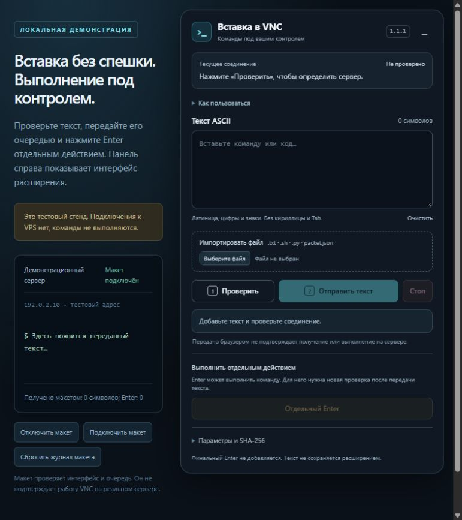
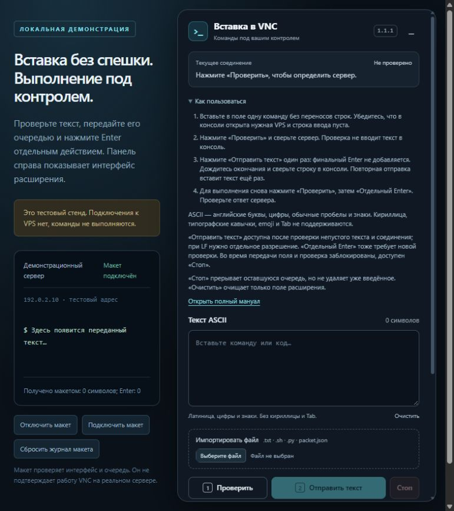
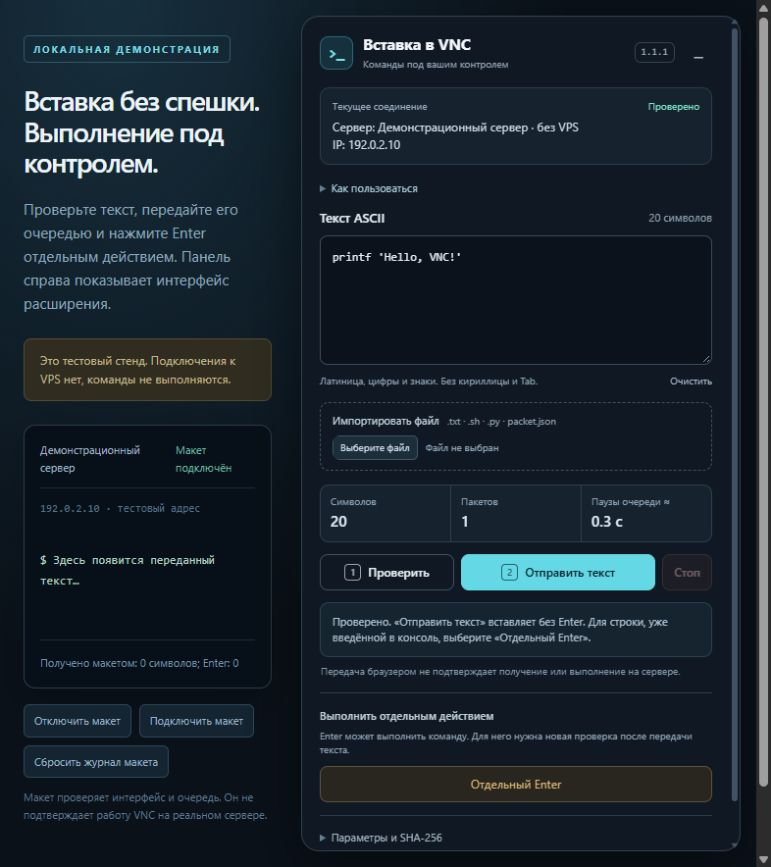
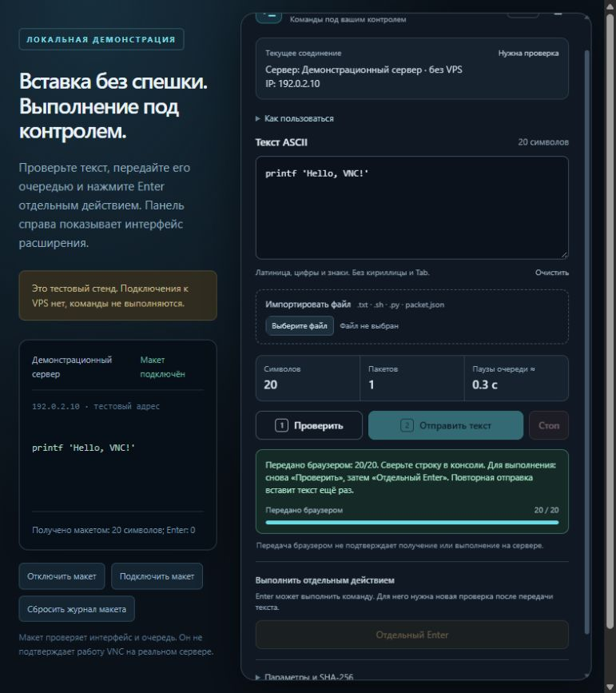
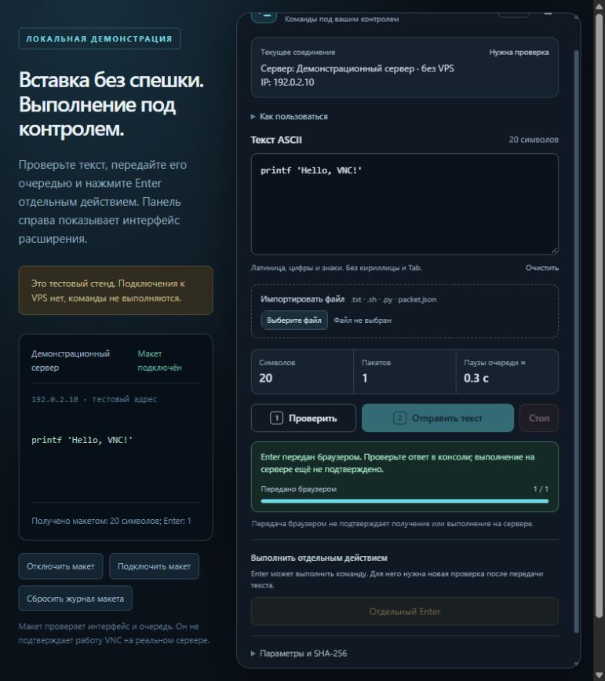
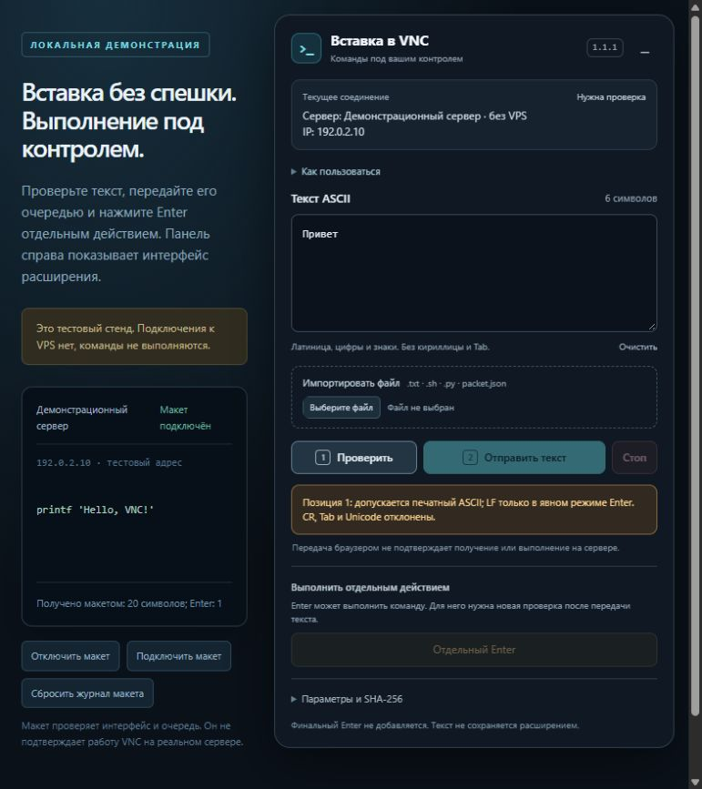
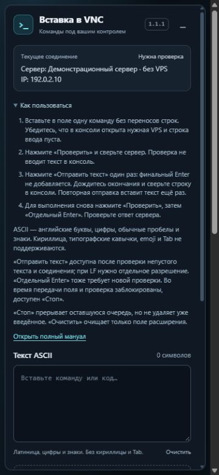

# Проверка понятности интерфейса 1.1.1

Дата: 24.10.2026. Экспертное прохождение локального стенда в браузере. Все снимки ниже сделаны в этом проходе. Реальный VPS не подключался; пользовательского исследования и полной проверки WCAG не проводилось.

Основной путь читается последовательно: добавить текст → проверить → отправить один раз → сверить консоль → проверить снова → отдельно нажать Enter. В версии 1.1.1 добавлены раскрываемая помощь, руководство, пояснения ASCII и настроек, подсказки действий и разные сообщения после текста, LF и отдельного Enter.

## 1. Старт — работает

Видны сервер, поле текста и основной порядок действий. Send и Enter недоступны без проверки; ASCII объяснён под полем. Помощь по умолчанию закрыта. Вторичный текст компактный: его чтение при различных настройках масштабирования и экранными дикторами требует отдельной проверки.

## 2. Помощь — работает, при раскрытии нужна прокрутка

Четыре шага объясняют первую однострочную команду; отдельно указаны ограничения текста, причины недоступности кнопок и последствия Stop/Clear. Полный мануал открывается по ссылке. Помощь закрыта по умолчанию, чтобы не вытеснять основные действия. Проверено закрытие помощи клавишей Enter.

## 3. Проверка — работает без ввода

Для `printf 'Hello, VNC!'` показаны 20 символов и одна часть; макет по-прежнему получил 0 символов и 0 Enter. Показана точная цель, расчёт пауз и различие между вставкой текста и выполнением уже введённой строки.

## 4. Передача — работает, следующий шаг указан

Макет получил ровно исходные 20 символов и 0 Enter. Статус требует сверить консоль, повторить проверку перед Enter и предупреждает о дублировании текста при повторной отправке. Завершение сбрасывает допуск; обе кнопки отправки снова недоступны. На ограниченной высоте панель прокручивается, статус и действия доступны.

## 5. Отдельный Enter — работает

После новой проверки кнопка отправила ровно один Enter; число символов осталось 20. Сообщение требует проверить ответ сервера и не объявляет исполнение доказанным. Макет не исполняет команды ОС.

## 6. Очистка и ошибка ввода — работают

Clear очистил только поле расширения; журнал макета сохранил 20 символов и 1 Enter. Кириллица отклонена до передачи с указанием позиции; Send и Enter недоступны. Термины LF, CR, Unicode дополнительно поясняются в руководстве.

## 7. Узкий экран — без горизонтального переполнения

При 375 × 812 панель занимает 344 px, её границы 8–352 px при доступной ширине 360 px; ширина содержимого также 360 px. Открытая помощь требует вертикальной прокрутки. Это проверка компоновки, а не обещание удобства полноценной VNC-работы на телефоне. После проверки временный размер сброшен, тестовая вкладка закрыта.

## Дополнительные проверки и ограничения

Локальный набор Node: 60/60. Python-проверки упаковщика и тестовых файлов: 5/5. Для изменённых обработчиков проверены LF-согласие, Stop, Clear, отмена прежней проверки и разные финальные статусы. Независимое ревью новых исходников и руководства не выявило существенных дефектов. Транспортные файлы и разрешения расширения не менялись.

Остаётся отдельной проверкой: установка/Reload в пользовательском браузере и доставка конкретной операции на VPS с серверным подтверждением. Скриншоты и счётчик браузера не заменяют эту проверку.
